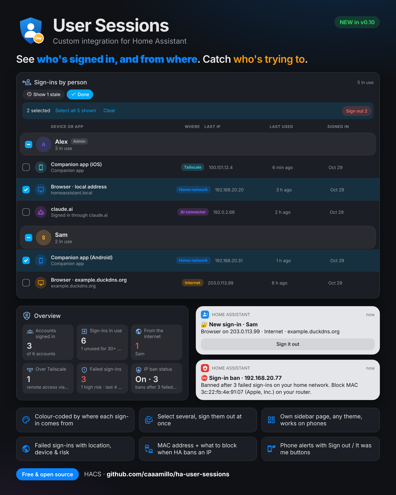
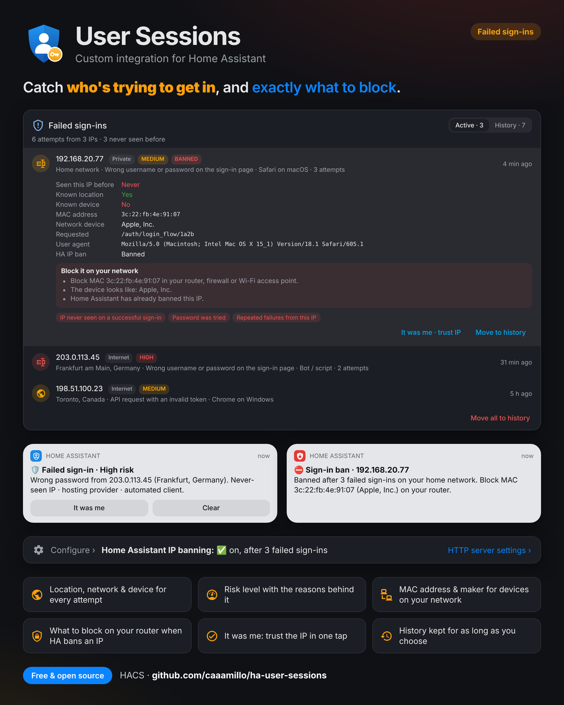
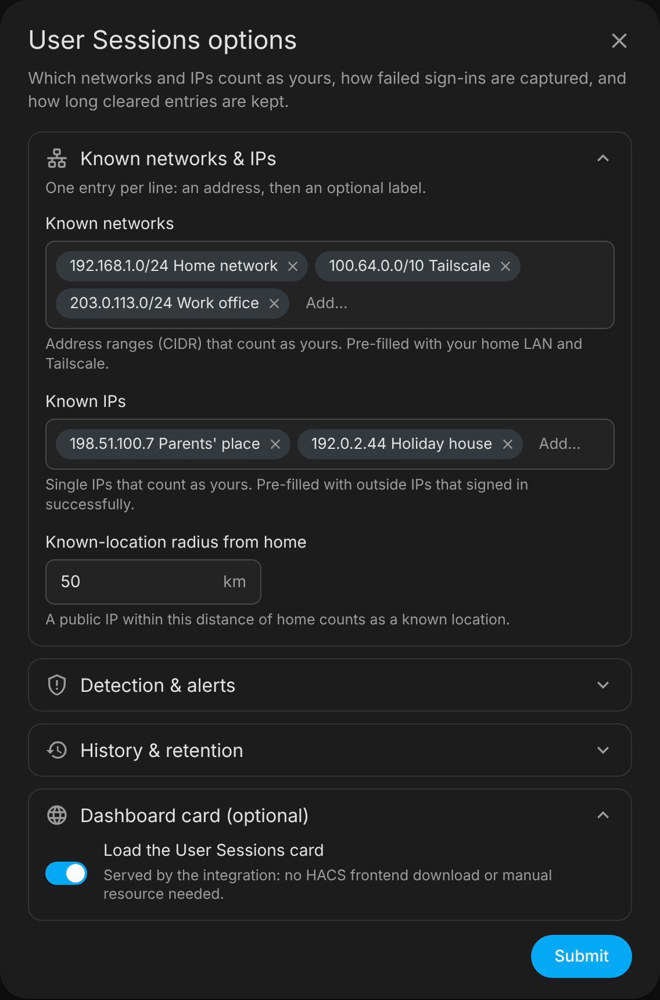
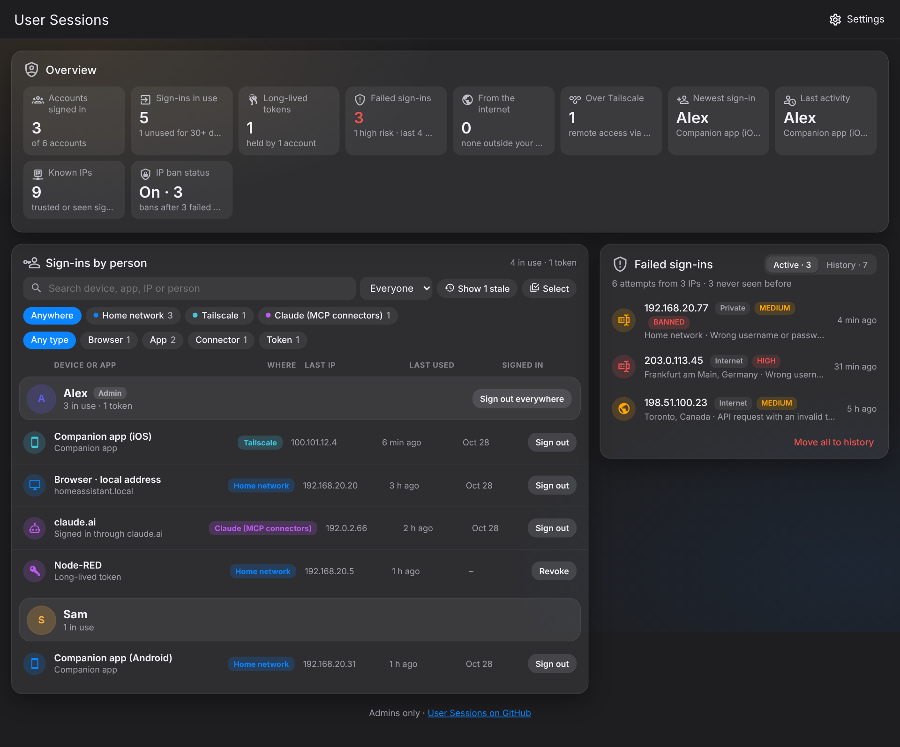
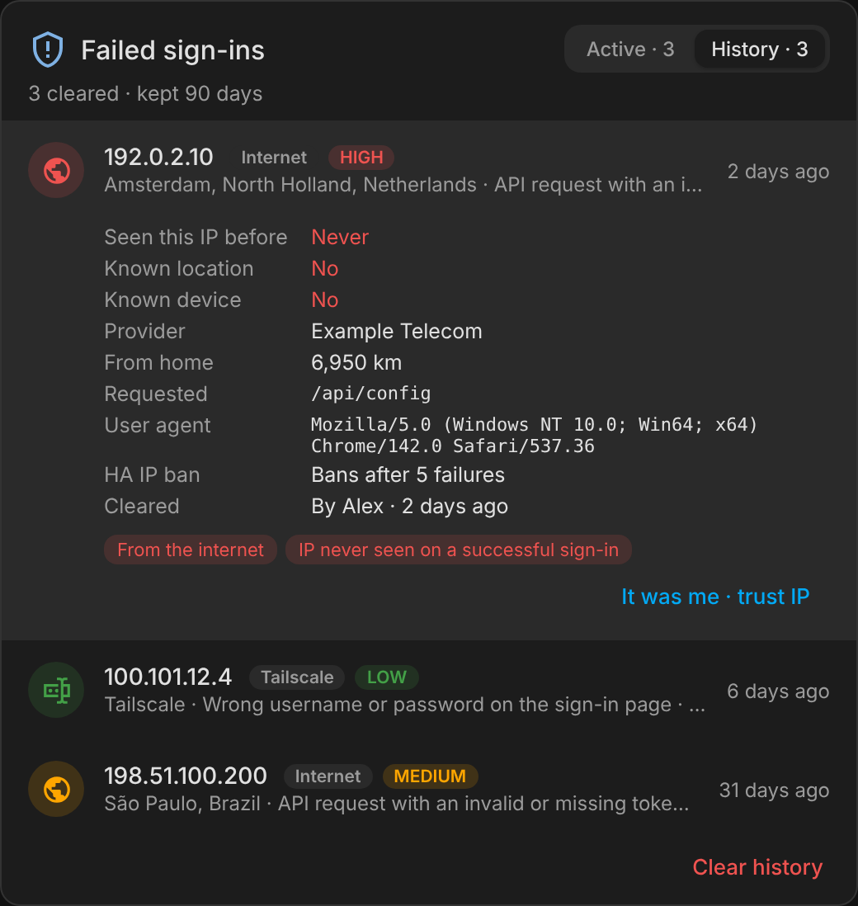
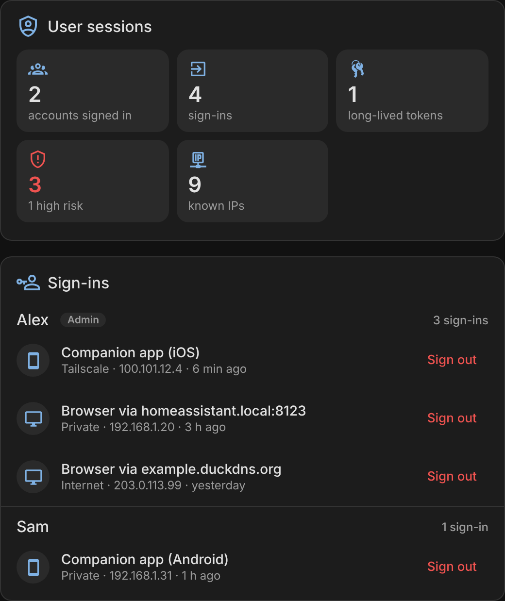

# User Sessions for Home Assistant

See **every** user's sign-ins and long-lived tokens in one place, get alerted about new and **failed** sign-ins (with location, device, MAC address and risk), get told exactly what to block when Home Assistant bans an IP, and sign anyone out — from automations, notifications or your dashboard.

Home Assistant only shows each user their *own* sessions (Profile → Security). This integration runs inside HA, so it can list everyone's.

<p>
  
  
</p>

> Screenshots use made-up demo data: documentation-only IP ranges (RFC 5737) and invented names.

## Features

- **Sign-in register** — one sensor per user: every active sign-in with client, how it signed in (browser / Companion app / token), first seen, last used and last IP. Plus totals and a long-lived-token count.
- **New sign-in events** — `user_sessions_new_session` fires for every new sign-in or long-lived token, enriched with network type, location and whether that IP has ever signed in before.
- **Failed sign-ins** — every wrong password and every request with a bad token is captured (from HA's own `http.ban` log line) and enriched:
  - IP, reverse DNS, requested URL, user agent → browser / OS / device type / bot detection
  - Geolocation (city, region, country, ISP, ASN, distance from home, VPN / data-centre flags)
  - *Seen this IP before?* *Known location?* *Known device?*
  - HA IP-ban status and threshold
  - For attempts from your own network: the device's **MAC address**, name and maker (from the ARP table or any router integration's device trackers)
  - A **low / medium / high risk** score with the reasons
  - Repeat attempts from one IP are folded into one entry (no alert storms)
  - Attempts logged before the integration started are back-filled on start-up
- **Ban prompts** — when HA's IP ban fires, a notification and a `user_sessions_ip_banned` event tell you exactly what to block on your own router or firewall (MAC for local devices, IP/range for internet ones). The integration never blocks anything itself, so it works with any network gear.
- **History & retention** — clearing moves entries to a history (who cleared it and when), pruned by age and size; optional auto-archive.
- **Known networks & IPs** — editable lists in the options form, pre-filled with your LAN (from HA's network adapters), Tailscale, and IPs that have signed in successfully. Add labels like `203.0.113.0/24 Work office`.
- **Phone notifications (optional)** — pick your Companion-app phones in the options to get alerts for new sign-ins, failed sign-ins (with a minimum risk) and IP bans, with *It was me*, *Clear* and *Sign it out* buttons. Off until you pick a phone.
- **Optional sidebar panel** — a **User Sessions** page in the sidebar (admins only) with the overview, failed sign-ins and everyone's sign-ins in one place. Nothing to set up on a dashboard.
- **Optional dashboard card** — a small, theme-aware card that ships with the integration (off by default).
- **Admin-only actions** — sign out a user, revoke one session or token, clear failed sign-ins, clear history, trust / forget an IP.

## Requirements
Home Assistant **2026.3** or newer (for the bundled icon; everything else works on 2025.1+).

## Installation

### Marketplace (Home Assistant 2026.11+)
1. **Settings → Marketplace → Add from link**, paste `https://github.com/caaamillo/ha-user-sessions`, type **Integration**.
2. Install **User Sessions** and restart Home Assistant (the Marketplace raises a repair you can restart from).
3. **Settings → Devices & services → Add integration → User Sessions.**

### HACS (Home Assistant before 2026.11)
1. HACS → ⋮ → **Custom repositories** → add `https://github.com/caaamillo/ha-user-sessions`, type **Integration**.
2. Install **User Sessions**, restart Home Assistant, then add it under **Settings → Devices & services**.

### Manual
Copy `custom_components/user_sessions` into your `config/custom_components/` folder and restart.

Updates: releases are published on GitHub, so the Marketplace/HACS lets you pick from the latest versions.

## Configuration
Everything is in the UI: **Settings → Devices & services → User Sessions → Configure**.



| Section | Option | Default |
|---|---|---|
| Known networks & IPs | Known networks (CIDR + optional label) | Your LAN + `100.64.0.0/10 Tailscale` |
| | Known IPs (IP + optional label) | Outside IPs with successful sign-ins |
| | Known-location radius | 50 km |
| Detection & alerts | Capture failed sign-ins | On |
| | IP geolocation | ip-api.com |
| | Look up the device (MAC) for local attempts | On |
| | Notify me what to block when HA bans an IP | On |
| | Session check interval | 30 s |
| | Dismiss HA's "Login attempt failed" notification when cleared | On |
| History & retention | Keep history for | 90 days |
| | Maximum history entries | 500 |
| | Auto-archive uncleared entries after | 0 (never) |
| Phone notifications | Send to (Companion-app phones) | None (nothing sent) |
| | New sign-ins / Failed sign-ins / IP bans | On (once a phone is picked) |
| | Only failed sign-ins at or above | Low (everything) |
| | Open when tapped | — |
| Sidebar panel & card | Show User Sessions in the sidebar | Off |
| | Sidebar panel theme | Each person's own theme |
| | Load the User Sessions card | Off |

## Sidebar panel (optional)

Turn on **Configure → Sidebar panel & dashboard card → Show User Sessions in the sidebar**. A **User Sessions** entry appears in the sidebar for admins: every overview tile, failed sign-ins (Active / History) and sign-ins by person with sign-out, on one page that works on phones too. It ships with the integration, so it updates with it; there's no dashboard to create or maintain. Pick any installed theme for it under *Sidebar panel theme* (used for this page only, like a dashboard view's theme). The sign-ins section has search, a person picker and *where* / *type* filters; your labelled known networks become the *where* filters automatically. Each sign-in is colour-coded by where it comes from, and you can select several to sign out at once or reveal stale ones.



## Dashboard card (optional)

Turn on **Configure → Dashboard card → Load the User Sessions card**. The integration serves the card itself and loads it into your dashboards, so there's no separate HACS download or resource to add. Turning it off unloads it again.

Then add it from the card picker (**User Sessions**). The visual editor lets you pick the view and, for the summary, tick exactly which tiles to show. Or in YAML:

```yaml
type: custom:user-sessions-card
view: failed      # failed (default) | sessions | summary
title: Failed sign-ins   # optional
max: 6                   # rows before "Show all"
tiles:                   # summary view only; omit for the first five
  - accounts             # accounts signed in, of N accounts
  - signins              # sign-ins in use, unused for 30+ days
  - tokens               # long-lived tokens, held by N accounts
  - failed               # failed sign-ins, last attempt
  - known_ips            # known IPs
  - internet             # optional: sign-ins from outside your known networks
  - tailscale            # optional: sign-ins over Tailscale
  - newest               # optional: newest sign-in (who, how, where)
  - last_activity        # optional: who used Home Assistant last
  - ip_ban               # optional: Home Assistant's IP-ban status
filters: true            # sessions view: search, person picker, where / type chips
show_tokens: true        # sessions view: list long-lived tokens too
select: true             # sessions view: Select button to sign out several at once
stale: true              # sessions view: hide sign-ins unused for 30+ days behind a button
where: Home network      # sessions view: start filtered (any known-network label, Internet, Tailscale…)
type: browser            # sessions view: start filtered (browser | app | connector | token)
```

*Connector* means another service that signed in to Home Assistant through its sign-in page, such as an AI assistant's MCP connector.

| `view: failed` — Active / History, tap a row for details | `view: summary` and `view: sessions` |
|---|---|
|  |  |

It uses your theme's colours, works on phones (details stack under each row), and every destructive button asks for a second tap.

## Entities

| Entity | State | Key attributes |
|---|---|---|
| `sensor.user_sessions_<user>_sessions` | active sign-ins | `sessions`, `long_lived_tokens`, `last_ip`, `last_via` |
| `sensor.user_sessions_total_user_sessions` | all sign-ins | `users`, `users_signed_in` |
| `sensor.user_sessions_long_lived_tokens` | all tokens | `by_user` |
| `sensor.user_sessions_failed_sign_ins` | uncleared entries | `entries`, `highest_risk`, `last_ip`, `last_location` |
| `sensor.user_sessions_failed_sign_in_history` | history entries | `entries` (newest 50), `retention_days` |
| `sensor.user_sessions_known_ips` | known IPs | `ips`, `trusted`, `known_networks` |

Large list attributes are excluded from the recorder so your database doesn't grow.

## Events

- `user_sessions_new_session` — `user_name`, `kind` (`session` / `long_lived`), `via`, `client_name`, `last_ip`, `network`, `location`, `known_ip`, `known_location`, `risk`, `risk_reasons`, `session_id`
- `user_sessions_failed_login` — `ip`, `description`, `attempt_type` (`password`, `api`, `websocket`, `token_exchange`, `webhook`), `location`, `isp`, `device`, `known_ip`, `known_location`, `risk`, `risk_reasons`, `attempts`, `is_new`

- `user_sessions_ip_banned` — fires when HA's IP ban bans an address. Everything in the failed sign-in entry plus `banned_at`, `mac`, `lan_device` (`mac`, `name`, `vendor`, `randomized`, `source`), `known_mac` and `block_advice` (a list of plain-language steps)

Tip: trigger notifications on `user_sessions_failed_login` with `event_data: {is_new: true}` so repeat attempts don't re-alert.

## Actions

| Action | Fields |
|---|---|
| `user_sessions.sign_out_user` | `user_id` or `user_name`, `include_long_lived` |
| `user_sessions.sign_out_session` | `session_id` |
| `user_sessions.clear_failed_sign_ins` | optional `entry_id` or `ip` (none = all) |
| `user_sessions.clear_history` | optional `older_than_days` (none = all) |
| `user_sessions.trust_ip` | `ip`, optional `label` |
| `user_sessions.forget_ip` | `ip` |

All are admin-only.

## Phone notifications

The simplest way: **Configure → Phone notifications**, tick your phone(s), done. You get:

| Alert | When | Buttons |
|---|---|---|
| 🔑 New sign-in / long-lived token | A new device or token appears | Sign it out |
| 🛡️ Failed sign-in · *risk* | First failed attempt from an IP (repeats don't re-alert), at or above your minimum risk | It was me (trust IP) · Clear |
| ⛔ Sign-in ban | Home Assistant's IP ban blocks an address | — |

Buttons only work when the person who taps is an admin. Prefer your own automations? Leave *Send to* empty and use the events below; the example shows the idea.

## Example: actionable failed sign-in alert

```yaml
triggers:
  - trigger: event
    event_type: user_sessions_failed_login
    event_data: { is_new: true }
actions:
  - action: notify.mobile_app_your_phone
    data:
      title: "Failed sign-in · {{ trigger.event.data.risk | title }} risk"
      message: >-
        {{ trigger.event.data.description }} from {{ trigger.event.data.ip }}
        ({{ trigger.event.data.location or 'unknown location' }})
      data:
        actions:
          - action: "USERSESS_TRUST_{{ trigger.event.data.ip }}"
            title: It was me
          - action: "USERSESS_CLEAR_{{ trigger.event.data.ip }}"
            title: Clear
```

## IP bans and MAC addresses
IP banning is a Home Assistant setting, not part of this integration: turn it on under **Settings → System → Network → HTTP server** (*Enable IP banning*, turn off *Unlimited login attempts*, then set *Login attempts before ban*). User Sessions helps you get it right:
- The **Configure** screen shows whether banning is on and after how many attempts, with a link to the HTTP server settings.
- While banning is off (or set to unlimited attempts) a **Repairs** notice explains how to turn it on, including the reverse-proxy pitfall. It clears itself once banning works, or you can ignore it.
- The card shows "Bans after N failures", or "Off · turn on".

Behind a reverse proxy or tunnel, set *Trust X-Forwarded-For* and *Trusted proxies* first, or Home Assistant may ban the proxy and lock everyone out. If User Sessions shows real visitor IPs, you're fine.
 When an address is banned you get a notification titled **Sign-in ban: block this device?** with the IP, where it came from, the device and what to do. Clearing the entry dismisses it.

A MAC address only exists on the local network segment, so:
- **Local attempts** (same LAN/VLAN as Home Assistant): the MAC is read from the ARP table, and named from any `device_tracker` that reports `mac` (UniFi, FRITZ!Box, OpenWrt, ASUSWRT, Nmap…). Block it in your router or access point's client list.
- **Internet, Tailscale or reverse-proxy attempts**: no MAC is visible, only the IP. Block it on your firewall, or remove the device from your tailnet.
- Phones and laptops often use a **private (randomised) Wi-Fi address** that can change; the notification says so. Changing your Wi-Fi password is the surer fix for an unknown device.
- A device that has signed in successfully before is flagged, so you don't lock out a family member over a typo.

To lift a ban, delete the line from `ip_bans.yaml` in your config folder and restart.

## Privacy
- Only **public** IPs are sent for geolocation, and only when a failed or new sign-in happens. Results are cached for 7 days. Turn it off in options.
- ip-api.com's free tier is for non-commercial use and uses HTTP; choose ipwho.is (HTTPS) if you prefer.
- MAC addresses are read locally and never sent anywhere.
- Everything else stays in `.storage/user_sessions.*` on your instance.

## How failed sign-ins are detected
Home Assistant fires no event for a failed login. Every failure passes through `homeassistant.components.http.ban.process_wrong_login`, which logs one WARNING. The integration attaches a log handler to that logger only and parses the line. If you raise that logger's level above WARNING, capture stops.

## Limitations
- HA doesn't record the browser for *successful* sign-ins, so "known device" compares against devices seen from IPs you've trusted.
- Geolocation is approximate and VPN/hosting flags come from the provider.

## License
MIT
